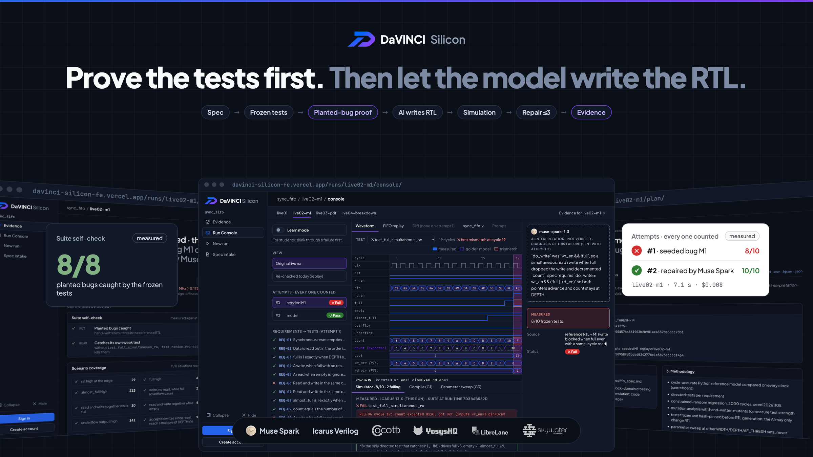
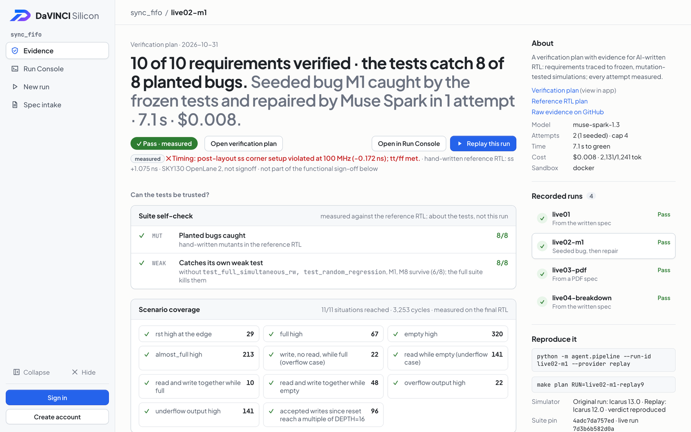
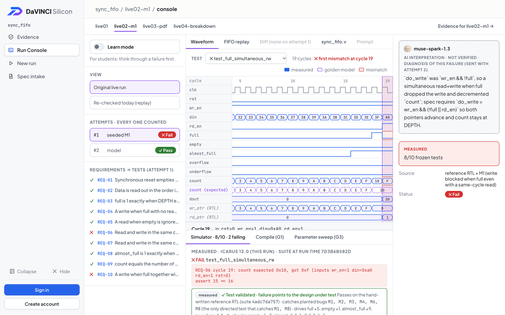
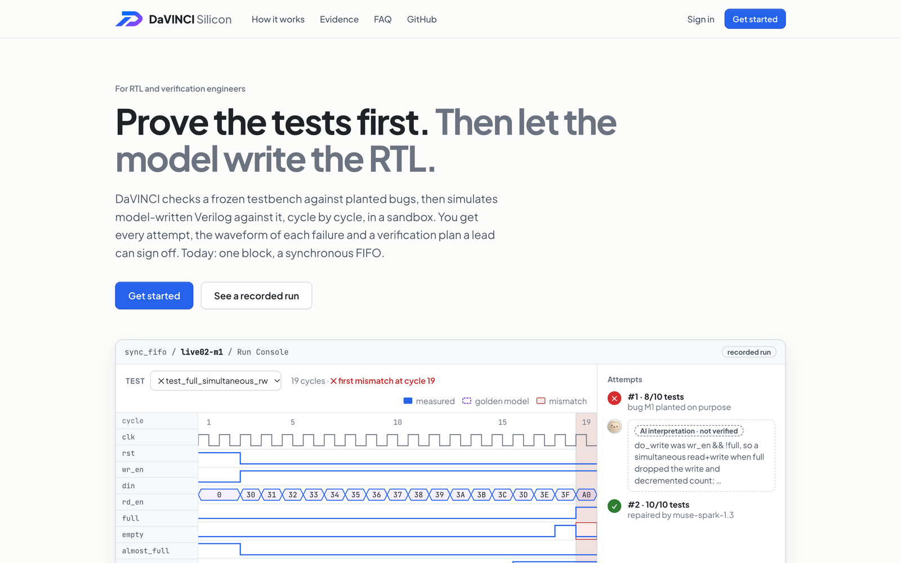

# DaVINCI Silicon



**DaVINCI Silicon turns a chip spec into a verification plan and proof your lead can sign off, then lets AI write and fix the RTL against it.**

What it shows, in this order:

1. **Can the tests be trusted?** Mutation testing against planted bugs, a weak-test check, scenario coverage and the plan's gaps.
2. **A verification plan a lead can sign off.** Requirement → frozen tests → planted bugs caught → measured result, with sign-off criteria met / not met / not measured (`.md`, `.csv`, OpenTitan-style `testplan.hjson`).
3. **Where and why it failed.** Every attempt, its waveform and FIFO replay at the failing cycle, and a measured "is it the design or the test?" line for each failing test.
4. **AI writes and repairs the RTL.** Muse Spark writes Verilog; it never sees, writes or grades the tests, and every attempt is simulated and counted.

Loop: spec → requirements (human-approved) → frozen tests → mutation proof → AI-generated RTL → real simulation → bounded repair → evidence report → replay.

**Live board:** https://davinci-silicon-fe.vercel.app/ — the Evidence board, Run Console and verification plans of every recorded run are public and need no account (served from the committed evidence bundle). New run and Spec intake need a signed-in account with live access and the API.

### UI sneak peek

Screens from the live board, recorded run `live02-m1` (seeded bug M1, caught by the frozen tests, repaired by Muse Spark in one attempt).

| Evidence board | Run Console |
| --- | --- |
|  |  |



The API is hosted on Modal at `https://adrianbadjideh--davinci-api.modal.run`: each compile, test run and sweep of model-written RTL runs in its own throwaway Modal Sandbox with no network and no secrets (`agent/modal_sandbox.py`; a $0 replay of `live02-m1` there reproduced the recorded verdicts). To run it locally instead, use `make api` (Docker running) and enter `http://127.0.0.1:8000` under Connection settings on the board's New run or Spec intake page. Chrome asks once to allow the site to reach your local network; allow it. The API only accepts the board's own origins (`CORS` in the Makefile).

Built for the Meta Global AI Developer Hackathon 2026 (Startup Track, "Push the Frontier"). Everything in this repo was written during the hackathon (Oct 27 – Nov 4, 2026).

## Status

| Part | State |
| --- | --- |
| Hand-written reference FIFO (`rtl/sync_fifo.v`) | done, 10/10 tests pass |
| Requirements REQ-01..10 (`spec/requirements.json`) | done |
| Frozen cocotb suite + Python golden model (`tests/`) | done |
| Suite mutation score vs reference RTL, 8 hand-written mutants (`verify/mutate.py`) | 8/8 killed |
| Parameter sweep at 3 other parameter sets, never shown to the model (`verify/run_sweep.py`, `tests_sweep/`) | done; reference passes, hard-coded widths fail |
| Docker sandbox (`docker/Dockerfile`, `make sandbox`, `--sandbox docker`) | done: no network, read-only tests, CPU/mem/pid caps, 120 s timeout |
| Model client: Meta / Baseten / replay, cost ledger, budget guard (`agent/llm.py`) | done; Meta tested live, Baseten not yet |
| Verified loop with bounded repair, evidence `run.json` (`agent/pipeline.py`) | done; 4 recorded live runs on Muse Spark 1.3 (`live01`, `live02-m1`, `live03-pdf`, `live04-breakdown`), each re-checked by a $0 replay under today's gates (`live04-breakdown`'s attempt 1 was falsely rejected by an older port check, fixed since; its replay passes on attempt 1) |
| HTTP API: runs, SSE progress, replay, mutation, ledger (`api/server.py`) | done |
| Image/PDF spec input → extracted requirements → human approval → RTL (`agent/extract.py`) | done |
| Web UI (`web/`, `make evidence board`): Evidence Board and Run Console as a static site over `evidence/`; New run (live progress) and Spec intake (upload → review → approve → run) against the API | done; API URL from `NEXT_PUBLIC_DAVINCI_API` or the page's Connection settings |
| Coverage gaps: mutation check with each test left out, single-test kills, requirements no mutant targets (`verify/gaps.py`, `make gaps`) | done; directed tests alone miss M1/M8 without `test_full_simultaneous_rw`; REQ-04 and REQ-09 have no mutant |
| Scenario counters: how often the frozen suite reaches full, empty, overflow/underflow cases, simultaneous read+write, wraparound (`verify/coverage.py`, `make coverage`) | done; every scenario reached on the reference and all exported RTLs |
| Waveform and FIFO replay of every attempt: per-cycle trace of the frozen tests with the golden model's expected values, drawn in the Run Console (`verify/trace.py`, `make trace`) | done; measured from the simulator, model RTL traced in Docker |
| Verification plan per run in the industry shape (Vplan sections, OpenTitan-style testpoints and sign-off, plus mutation evidence and AI provenance) as `.md`, `.csv` and `testplan.hjson`, from stored files only (`verify/plan.py`, `make plan`; format in `docs/verification-plan-format.md`) | done; in the evidence bundle and downloadable from the board |
| Design breakdown before RTL: Muse Spark proposes state, widths, pointer scheme and control/datapath per requirement; a person approves; the final RTL is checked against it (`agent/breakdown.py`) | done; `live04-breakdown`: 12/12 planned elements present in the final RTL, 10 widths match, 2 not checked |
| Formal properties with SymbiYosys on the reference and every exported model RTL (`verify/formal.py`, `formal/`) | done; 6/6 hand-written properties proved (unbounded) on all (they cover the occupancy count and status flags; simulation covers the data path); they catch 3 of the 8 planted bugs (M2, M7, M8), the rest are behaviours no property states |
| SKY130 estimates: synthesis + static timing + power pre-layout (Yosys, OpenSTA), and a full open-source layout run with multi-corner timing (LibreLane/OpenLane 2) (`verify/sta.py`, `verify/layout.py`) | done for the reference and the 4 live RTLs; DRC/LVS clean and a GDS for all five; after layout, `live02-m1` passes every functional test but misses 100 MHz at the slow corner by 0.172 ns while the hand-written reference makes it (+1.075 ns); every design has slew violations at that corner. Open-source estimates, not foundry signoff |
| Generic cell and flip-flop count per RTL (`verify/area.py`) | done; reference 384 cells / 153 flip-flops |
| More blocks with their own frozen suites and planted bugs: saturating gain stage (bit-accurate golden model) and round-robin arbiter (`blocks/`) | done; 7/7 planted bugs caught on each; recorded live model runs are all on `sync_fifo` |
| Learn mode: per requirement an explanation and a question, answers checked against the golden model (`agent/learn.py`) | done; written by Muse Spark (AI interpretation), 10/10 answers match the golden model |
| Accounts: email + password, Google and GitHub sign-in; accounts are read-only until live access is granted by hand (`api/users.py`, `api/auth.py`) | done; unit-tested (`make unit`) |

## Run

```bash
pip install -r requirements.txt   # plus Icarus Verilog (brew install icarus-verilog / apt install iverilog)
make sim                      # run the frozen suite against rtl/sync_fifo.v
make mutate                   # mutation score of the suite
make weak-demo                # weakened suite lets mutants survive; full suite kills them
make image && make sandbox    # same run inside the locked-down container
python -m agent.pipeline --run-id dry01 --provider fake          # offline loop, $0
python -m agent.pipeline --run-id demo01 --seed-bug M1           # seeded bug → repair
python -m agent.pipeline --run-id sbx01 --sandbox docker        # simulate inside the sandbox
make api                                                         # HTTP API on :8000
make gaps                                                        # where the test plan is thin (37 s, local)
make coverage RUN=live01-replay-7c96                             # scenario counts on a run's final RTL (in Docker)
make trace RUN=live02-m1                                         # waveform/FIFO trace of each attempt (in Docker)
make plan RUN=live01                                             # runs/live01/verification_plan.{md,json}, $0, no simulation
make plan-ref                                                    # same for the reference RTL (simulates it locally)
make evidence                                                    # export live runs + replays + their plans to evidence/
make board                                                       # build the Evidence Board to web/out
python -m agent.extract spec/fixtures/sf16_datasheet.pdf         # spec page → requirements for approval
python -m agent.extract --remap <xid>                            # re-run only the mapping step
python -m agent.extract --approve <xid> --by "Name"              # approve; then run with
#   --requirements runs/_extract/<xid>/approved.json --spec runs/_extract/<xid>/interface_spec.md
python -m agent.pipeline --run-id demo01 --provider replay       # replay a recorded run, $0
```

Each run writes `runs/<id>/run.json` (every attempt, cost, status) plus, per attempt, `attempt_<n>/sim/verdict.json` (RTL hash, suite hash, simulator, per-test results) and, on a visible pass, `attempt_<n>/sweep/sweep.json`.

## How a design is judged

| Gate | Check | Tool |
| --- | --- | --- |
| G1 static | no `$` or compiler directive except `` `timescale ``; no `initial` or `#` delays; ports match `spec/interface.json`; compiles as Verilog-2001 | regex, `iverilog -g2001 -Wall` |
| G2 visible | 10 frozen tests, golden model compared every cycle, default parameters | Icarus + cocotb |
| G3 sweep | the same golden model at WIDTH/DEPTH/AF_THRESH = 8/12/9, 1/2/1, 32/32/32; results never shown to the model | Icarus + cocotb |

Run statuses: `pass` (G1–G3), `escaped` (passed the visible suite, failed the sweep), `needs_engineer` (repairs exhausted; failing tests handed over), `no_progress` (the same design twice), `aborted`, `not_verifiable` (spec or requirements the suite cannot judge; no model call). Attempt statuses add `rejected` and `truncated` (reply cut off at the token limit).

## Limitations and roadmap

**Today.** DaVINCI shows the tests are strong (planted bugs, weak-test check, scenario counts, plan gaps) and measures every AI attempt against them, end to end for one block, a sync FIFO, on open-source tools. Formal properties and SKY130 timing/power/layout estimates sit next to the simulation results; two more small blocks have frozen suites and planted bugs.

**Not yet:**

- **Proving the reference model is correct.** The tests are shown to be strong and to agree with a hand-written reference RTL; both share `tests/golden_model.py`, so a misreading of the spec shared by the reference and the model would pass both.
- **Code coverage.** Icarus Verilog has none; coverage here is planted-bug coverage plus scenario counts, not line, toggle or covergroup coverage. REQ-04 and REQ-09 have no planted bug yet.
- **Complete formal proof.** Six hand-written properties are proved; they do not state every requirement, so they catch only 3 of the 8 planted bugs. Simulation remains the main check.
- **Signoff-grade timing and power.** SKY130 numbers come from open-source flows with default constraints and activity; they are estimates per design, placement varies between runs, and the slow corner shows slew violations. Not a foundry or commercial signoff flow.
- **Microarchitecture from an ambiguous spec.** The design breakdown is proposed by the model and approved by a person; it is checked against the final RTL, not derived or proven correct.
- **More than one block end to end.** The gain stage and arbiter have frozen suites and planted bugs, but every recorded live model run is on the sync FIFO.
- **Rates.** Results are individual recorded runs (4 live runs), not a benchmark; no success rate is claimed.
- **Hosting capacity.** The API runs on Modal (`modal_app.py`) on a starter credit: one container that sleeps when idle, so the first request after a pause takes a few seconds, and new runs show results without a waveform (traces still need Docker).

Also worth knowing:

- **The default spec contains the reference equations** (`spec/fifo_spec.md` states `do_write = wr_en && (!full || rd_en)`), so first-pass success on it measures spec-conformant transcription, not design from an ambiguous spec. The PDF-spec run (`live03-pdf`) starts from an extracted, approved list instead.
- **The planted-bug score describes the test suite**, measured against the reference RTL with 8 hand-written mutants; it is not a property of any generated RTL.
- **Replay re-simulates recorded model output.** It checks the pipeline and simulator are deterministic, not that the model would answer the same way again.

**Next:** design-vs-testbench triage beyond reference validation; live runs on the other blocks; a benchmark with rates; waveform traces for hosted runs.

**Not in this hackathon:** foundry signoff, full-chip integration, analog/mixed-signal, self-serve billing.

## Built with Meta AI

**In the product: Muse Spark 1.3** (Meta Model API) writes and repairs the RTL, extracts requirements from a datasheet PDF or image, proposes the design breakdown before RTL, and writes the Learn-mode explanations. Every call is in `runs/_ledger.jsonl` with its tokens and cost, and its text is always labelled AI interpretation.

**In development: Muse Code**, Meta's terminal coding agent, run headless (`muse exec`) on scoped tasks. Each session is recorded in `docs/muse-code/` with the prompt, the files it read and wrote, the tests it ran and a hand review, and the commits it produced say so in their message.

| Date | Session | What Muse Code wrote |
| --- | --- | --- |
| 4 Nov 2026 | [auth unit tests](docs/muse-code/2026-11-04-auth-unit-tests.md) | `tests_unit/test_auth_accounts.py` (19 tests for accounts, sessions, OAuth state and avatar hosts) and the `make unit` target |

## Rules the AI must follow

- Tests and the golden model are frozen: the repair agent may only edit RTL; `suite_sha256` is checked every run.
- Every result shown is labelled measured (simulator) or AI interpretation (not verified).
- All attempts are counted, including failures.
- Model-written RTL is only simulated inside the Docker sandbox; live model calls through the API need an account with live access (granted by hand) or an issued token.

Architecture review and decisions: `docs/architecture/`.
