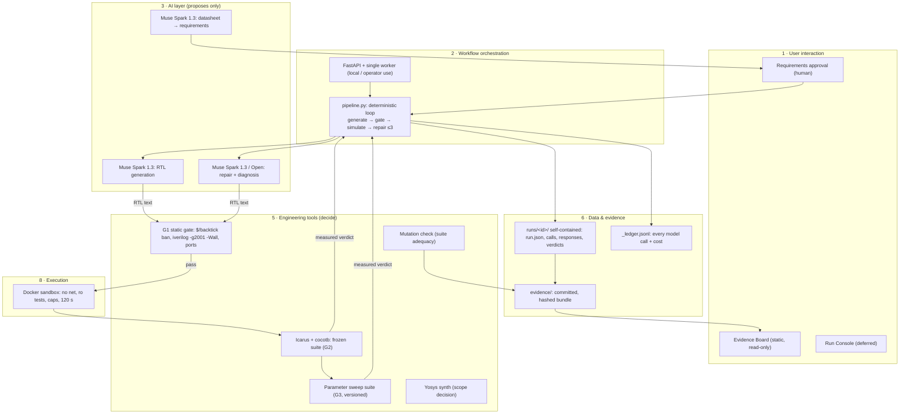
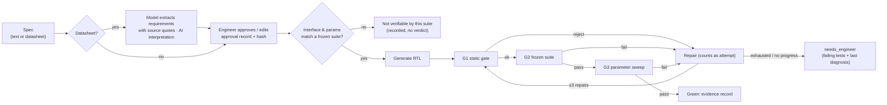
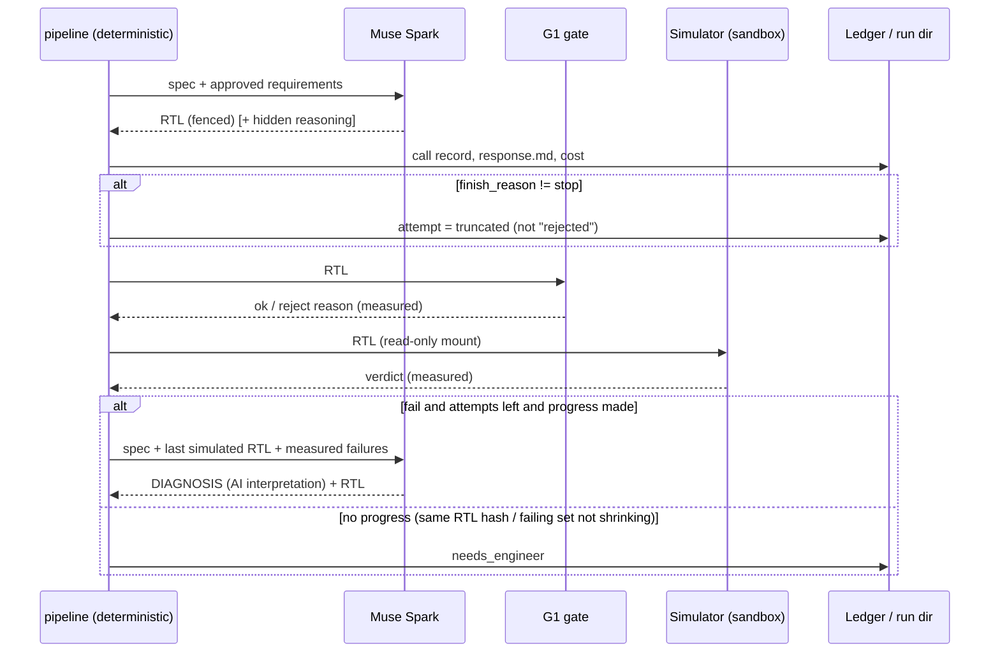
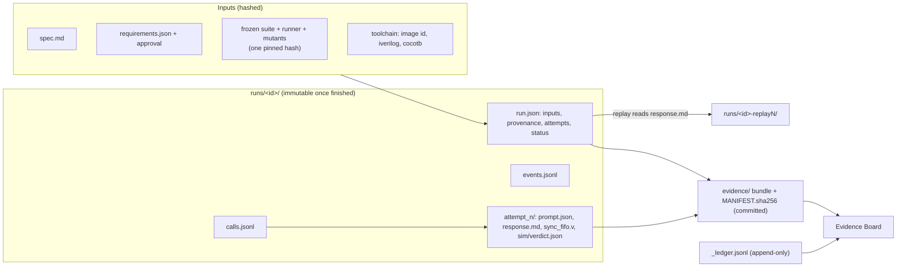
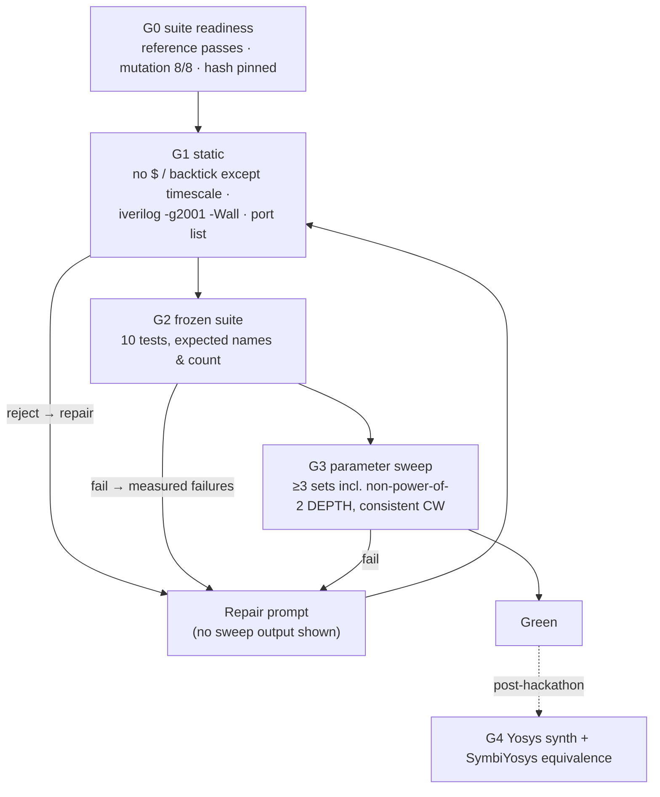

# 02 — Target system architecture

**Status:** proposal, 31 Oct 2026. It reconciles the eight domain reviews and two red-team passes (`01-multi-domain-review.md`). Nothing here is validated by users or by experiments yet; §7 lists what would validate it.

## 1. Design stance

The smallest architecture that can make one honest, measurable claim beats a platform that makes many unmeasured ones. The reviews converge on:

1. **DaVINCI's defensible core is the trust layer, not generation.** That means a frozen, hash-pinned oracle the AI cannot touch, mutation-checked suites, every attempt counted, and replayable evidence. Generate → simulate → repair is standard practice that incumbents already ship (Synopsys AgentEngineer, Siemens Questa One Agentic Toolkit, Cadence ChipStack, ChipAgents; see `01` §2D).
2. **Deterministic tools decide; models propose.** Every verdict comes from a simulator or compiler. Model text is stored, labelled "AI interpretation · not verified", and never feeds a verdict.
3. **No world model, no runtime multi-agent system.** The cycle-accurate golden model is the exact dynamics model for this domain. A learned predictor would be slower to trust and less accurate than a 0.3 s simulation (`01` §2E).
4. **One block, one machine, files on disk** until a second block or a second user forces otherwise.

### Hackathon target vs product hypothesis

| | Hackathon (submit 4 Nov) | Post-hackathon product **hypothesis** (not a decision) |
| --- | --- | --- |
| Claim | "Spec-conformant RTL generation under independent verification, on one block, with every attempt counted" | "A trust gate for RTL from any source": qualify the tests, run any candidate, emit replayable evidence |
| AI role | Muse Spark writes and repairs RTL; extracts requirements from a datasheet for human approval | Same, plus drafting oracles (properties, golden models) for human review, authored independently of the RTL |
| Headline evidence | Equation spec vs independently written prose spec, N = 10 each, visible suite + parameter sweep; M1–M8 seeded repair once each next to a trivial baseline | 5–10 DV-engineer interviews; one block from outside the team, with its own tests |
| Public surface | Static Evidence Board over a committed evidence bundle, with replay | Decided after interviews |

The pivot is labelled a hypothesis because no user evidence exists. The red team's objection stands: a trust gate still needs someone to write the customer's oracle (`01` §2D, `06` R3).

## 2. High-level architecture

Layer 4 (world model) is deliberately absent; see §5. Layer 9 (security and governance) is cross-cutting; see §6.

## 3. Engineering workflow

## 4. AI and agent orchestration

One deterministic loop owns control flow. Models are called as functions with a fixed contract and never decide whether to simulate, stop or pass.

Stop conditions: pass; repairs exhausted; no progress after 2 repairs; budget refused; model error. Nothing retries silently. Every stop is a recorded status.

## 5. World model and simulation layer: decision

| Question | Answer | Evidence |
| --- | --- | --- |
| Is a learned world model needed for functional RTL? | **No: remove from the architecture.** | `tests/golden_model.py` is an exact transition function. Simulation costs 0.23–0.39 s vs 6–27 s per model call. |
| What plays that role? | The cycle-accurate reference model plus Icarus. Call it that, not a "world model". | `CLAUDE.md` §8 already bans the term in copy. |
| Any future predictive model? | Possibly a PPA surrogate after synthesis exists. **Deferred, no build trigger set.** | No synthesis data exists, so any threshold would be invented (red team pass 2). |

## 6. Data flow and artifact lifecycle

Rules:
- **Content-addressed, never overwritten.** A run directory alone is enough to replay it. Replay reads that run's own `response.md` files in `calls.jsonl` order, not a shared cache keyed by prompt (fixes V1).
- **Hashes cover everything that decides a verdict.** The pinned suite hash covers the tests, the golden model, `verify/run_suite.py` and `verify/mutants.json`.
- **Mutation and weak-demo results carry the suite hash they ran against.** The board shows a score only next to runs with the same hash.
- **Storage choice: files plus JSONL now.** Postgres plus an object store once there are several concurrent users. A knowledge graph only if cross-block queries appear (no trigger set).

## 7. Verification and feedback loop

What each gate proves, and what it does not:

| Gate | Proves | Does not prove |
| --- | --- | --- |
| G0 | The suite catches 8 bugs its author thought of | That it catches bugs a model makes |
| G1 | No system tasks or preprocessor tricks; legal Verilog-2001; right ports | Synthesisability |
| G2 | Cycle-equivalence to the reference at default parameters, on the stimulus applied | General correctness |
| G3 | No hard-coded widths or depths, over the sweep | Correctness outside the sweep; independent authorship (same golden model) |
| G4 (post) | Synthesisable; formally equivalent to the reference within a bound | Equivalence to the *intent* if the reference is wrong |

A **visible pass with a G3 failure** is recorded as `escaped`, never as `pass`. The escape rate is the main false-confidence metric.

## 8. Layers: build, integrate, reuse, defer, remove

| # | Layer | Component | Decision | Horizon |
| --- | --- | --- | --- | --- |
| 1 | UI | Evidence Board (static over the evidence bundle, with replay) | **Build** | Hackathon |
| 1 | UI | Run Console | **Defer** (red-team cut 8) | Post |
| 1 | UI | Requirements approval screen | **Build** if image input is working by 2 Nov, else **Defer** | Hackathon |
| 2 | Orchestration | `agent/pipeline.py` loop | **Reuse** + add truncated / no_progress / needs_engineer | Hackathon |
| 2 | Orchestration | Agent framework / runtime multi-agent | **Remove** | — |
| 2 | Orchestration | Durable job table | **Defer** | Post |
| 3 | AI | Muse Spark 1.3 generation | **Integrate** (exists) | Hackathon |
| 3 | AI | Baseten repair | **Defer** unless credits are confirmed by 1 Nov | Hackathon / post |
| 3 | AI | Datasheet extraction with source quotes | **Build** (in progress elsewhere), interface-guarded | Hackathon |
| 3 | AI | Structured JSON repair output | **Defer** (red-team cut 4) | Post |
| 4 | World model | Learned world model / digital twin | **Remove** | — |
| 4 | World model | PPA surrogate | **Defer** | Research |
| 5 | Tools | Icarus + cocotb frozen suite | **Reuse** | — |
| 5 | Tools | G1 static gate (`$`/backtick ban, `-g2001 -Wall`, port check) | **Build** | Hackathon (P0/P1) |
| 5 | Tools | Parameter sweep suite (new files, own hash) | **Build** | Hackathon (P1) |
| 5 | Tools | Yosys synth | **Integrate**, *Adrian decides on scope* | Hackathon if allowed, else post |
| 5 | Tools | SymbiYosys equivalence, auto-generated mutants | **Integrate** | Post |
| 5 | Tools | OpenROAD / physical design | **Defer** | Research |
| 6 | Data | Self-contained runs, replay from run dir | **Build** (fix) | Hackathon (P0) |
| 6 | Data | Extended suite hash; mutation evidence bound to suite hash | **Build** | Hackathon (P0/P1) |
| 6 | Data | Committed evidence bundle | **Build** | Hackathon (P1) |
| 6 | Data | Provenance block, schema versions | **Defer** to post, except `git_commit` + toolchain in run.json (cheap) | Post |
| 6 | Data | Postgres, object store, knowledge graph | **Defer** | Post |
| 7 | Verification | Gates G0–G3, honest labels, escape metric | **Build** | Hackathon |
| 8 | Infra | FastAPI + one worker | **Reuse** for operator use; harden worker (try/except, health) | Hackathon |
| 8 | Infra | Hosted live simulation (Modal Sandbox, Volume, queue caps, cancel) | **Defer** unless Modal credits are confirmed by 1 Nov. *Contradicts the CLAUDE.md §6 Deploy task; Adrian decides.* | Hackathon / post |
| 9 | Security | Fail-closed token (`compare_digest`) | **Build** | Hackathon (P0) |
| 9 | Security | No local simulation of model RTL; server-chosen sandbox; scrubbed env | **Build** | Hackathon (P0) |
| 9 | Security | Data classification / provider policy gate | **Defer** | Post |

## 9. What would change this architecture

- **Prose-spec first-pass rate is close to the equation-spec rate.** Generation is genuinely capable on this block; move to a harder block sooner.
- **Prose-spec rate collapses.** That is the honest headline. The trust layer is what catches it, which supports the trust-gate hypothesis.
- **Interviews show DV teams already own mutation and evidence tooling.** The trust-gate hypothesis weakens; reconsider oracle drafting (AI writes properties and golden models, independently authored) as the core.
- **A block from outside the team can't be onboarded without days of oracle writing.** The kill criterion in `06` is hit.
